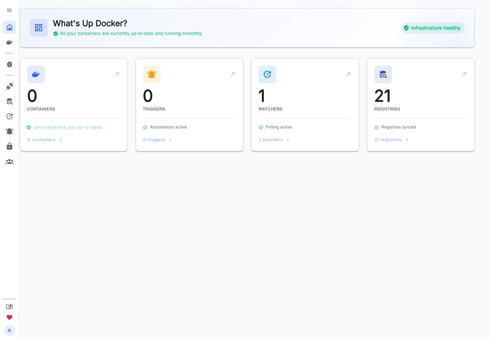

# WUD for TOS 7

[getwud/wud](https://github.com/getwud/wud) 的第三方 TOS 7 应用封装，支持 x86_64 和 aarch64。通过 WUD 网页界面监控 Docker 容器镜像更新，并配置通知。

**发布状态：上架准备中。** 包格式和本地容器测试已通过；当前固定的官方镜像存在 HIGH 漏洞发现，TNAS 实机记录尚未完成，因此正式发布检查保持阻塞。详情见 [验证记录](VALIDATION.md)。



## 安装与首次登录

应用 ID 为 `wud`，依赖应用中心的 `DockerEngine`。默认访问地址为 `http://NAS_IP:13000`。安装时需要从 Docker Hub 拉取已固定摘要的 `getwud/wud:9.8.0`，包内不包含镜像。

首次启动创建用户 **admin**，密码随机生成，位于所选存储卷：

```sh
sudo cat /Volume1/DockerAppData/wud/store/.tos/initial-admin-password
```

将 `Volume1` 替换为实际安装卷。也可在安装后的 Compose 目录执行 `docker compose exec wud cat /store/.tos/initial-admin-password`。凭据目录权限为 `0700`，文件为 `0600`；密码不写入日志。

在 WUD 中修改密码后，重启和容器重建均保留新密码。初始密码文件保留的是初始值；稳定的会话密钥保存在 `.tos/session-secret`。

TOS 当前文档说明 Docker 类型包通过应用中心分发，开发测试使用 [官方 TOSAppSelfTestingTool](https://github.com/terramaster-tos/tos-app-pkg-tools/releases/tag/v1.0.3-beta)。在 TNAS 上传对应架构的工具和包后执行，例如 x86_64：

```sh
chmod +x TOSAppSelfTestingTool_amd64
./TOSAppSelfTestingTool_amd64 -c wud.tar.gz
sudo ./TOSAppSelfTestingTool_amd64 -i wud.tar.gz
```

发布包应从本仓库的 **GitHub Releases** 下载，并按附件 `SHA256SUMS` 校验。正式 Release 需满足 [发布流程](docs/releasing.md) 的检查要求。

## 安装前检查

在 TNAS 上确认架构、socket 组和端口：

```sh
uname -m
stat -c '%u:%g %a' /var/run/docker.sock
ss -lnt | grep ':13000 '
```

容器运行用户为 `1000:1000`，附加 socket 组默认为 `0`。若设备的 socket GID 不同，可按实际值重新构建，例如 `python3 scripts/build.py --docker-gid 999`。重建后必须重新验证该包。应用不修改宿主 socket 的权限或所有者；需在实机确认 TOS 安装器保留此特殊挂载。

## 构建与验证

构建只依赖 Python 3.12+ 标准库，元数据发布者默认为 `Lu Yifei`：

```sh
python3 scripts/build.py
python3 scripts/build.py --platform x86_64 --publisher '你的发布者名称'
python3 scripts/check.py
node --test tests/start.test.cjs
python3 -m unittest discover -s tests -p 'test_*.py'
```

| 用途 | 输出 |
| --- | --- |
| Intel / AMD 测试包 | `dist/x86_64/wud.tar.gz` |
| ARM64 测试包 | `dist/aarch64/wud.tar.gz` |
| GitHub Release 附件 | `dist/release/wud_x86_64.tar.gz`、`wud_aarch64.tar.gz` |
| SHA256 | 各架构目录及 `dist/release/SHA256SUMS` |

每个包根目录恰好包含 `config.ini`、`wud.lang`、`wud.svg`、`docker-compose.yml` 四个文件。构建可复现。图标小于 50,000 字节并包含 viewBox；语言文件包含全部 26 个 TOS 语言区段，简体中文、繁体中文以外使用英文回退。

`runtime/start.cjs` 在构建时嵌入 Compose，负责首次凭据初始化。`packaging/image.lock.json` 固定 Docker Hub 镜像版本及摘要。`packaging/config.ini` 的 `beta` 暂为 `true`。

Docker 生命周期与镜像扫描：

```sh
python3 scripts/smoke.py --platform aarch64
python3 scripts/smoke.py --platform x86_64
python3 scripts/scan.py --platform aarch64
python3 scripts/scan.py --platform x86_64
```

网页交互和截图（需 Node.js 24）：

```sh
npm ci --ignore-scripts --no-audit --no-fund
npx playwright install chromium
python3 scripts/smoke.py --platform aarch64 --ui
```

测试创建独立容器、网络和临时存储，结束后清理。Linux 测试夹具会模拟 TOS 的数据目录所有权配置，并按测试主机 socket GID 调整测试容器的附加组。浏览器截图存于 `reports/screenshots/`，不含输入的密码。

CI 使用两个原生架构 runner，执行单元测试、包规范检查、官方 TOS 自检、容器生命周期和漏洞扫描；x86_64 runner 另执行网页验证。扫描发现 HIGH/CRITICAL 会阻止发布。CI 通过且实机证据完整时，Release workflow 才会创建草稿。

## 数据与卸载

持久化目录为 `/Volume<N>/DockerAppData/wud/store`，其中包含 SQLite 数据库、用户配置、会话和 `.tos` 凭据目录。

TOS 当前 Docker 应用更新方式为卸载后重装，并选择保留数据。操作前停止应用并备份整个 `store`；不要只复制正在使用的 SQLite 主文件。选择同时删除应用数据时，数据库和凭据也会删除。

## 权限与网络

| 资源 | 用途 |
| --- | --- |
| 容器 UID/GID `1000:1000` | 非 root 运行 WUD |
| Docker socket 附加组 | 访问宿主 Docker API |
| `/var/run/docker.sock` | `ro` 绑定挂载，读取容器、镜像和事件 |
| `/store` | 持久化数据库、账号和凭据 |
| TCP 13000 | 网页和 API，映射容器内 3000 |
| 外部网络 | Docker Hub 镜像拉取、镜像仓库查询、用户配置的通知渠道 |
| Shared Folder | None |

socket 的 `ro` 文件系统挂载无法限制 Docker API 操作，该接口仍有管理宿主容器的权限。默认配置每小时监控本机容器，自身标记为不监控；自动更新触发器由用户在 WUD 中配置。

包使用 bridge 网络、`cap_drop: ALL` 和 `no-new-privileges`。HTTP 入口面向可信局域网，跨公网访问请使用已有 HTTPS 反向代理。

## 开发与发布资料

- [贡献说明](CONTRIBUTING.md)
- [安全报告](SECURITY.md)
- [变更记录](CHANGELOG.md)
- [商店提交信息](docs/store-submission.md)
- [发布与实机验证流程](docs/releasing.md)
- [当前验证结果](VALIDATION.md)

WUD 本身的问题可提交到 [上游项目](https://github.com/getwud/wud/issues)，TOS 打包问题可提交到本仓库 Issues。

封装源码采用 [MIT](LICENSE) 许可。上游 WUD 与图标采用 [MIT](LICENSE.upstream) 许可，相关许可已分别随嵌入代码和图标包含在安装包内。此项目由社区维护，商店审核与上游 WUD 项目各自独立。
